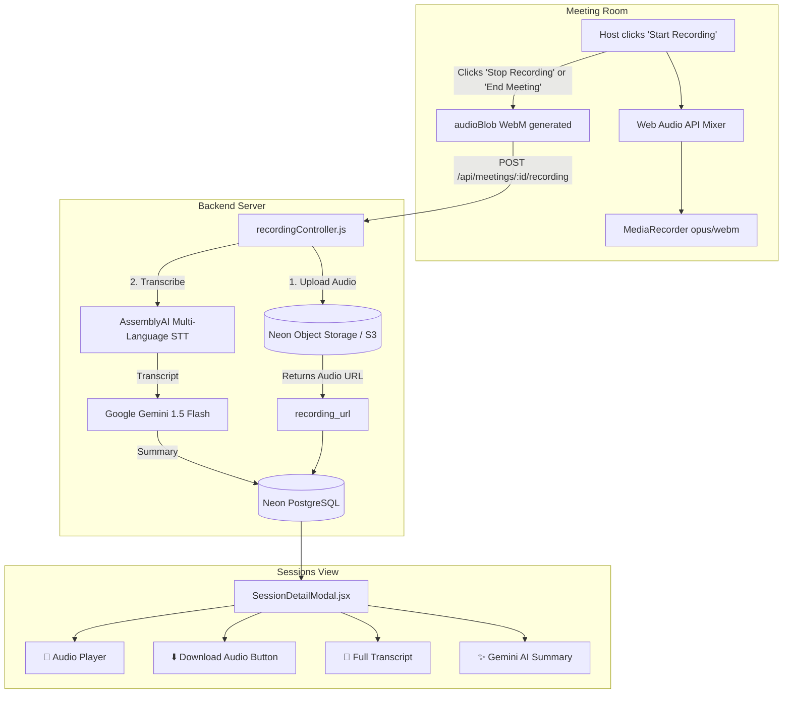

# 🎙️ AI Meeting Audio Recording, Object Storage & Download — Implementation Blueprint

> **Goal**: 
> 1. Give the **Meeting Host** full manual control to **Start and Stop Audio Recording** on demand with a visual `🔴 REC` timer in the call.
> 2. Persist the recorded audio file to **Neon Database Object Storage** (or S3-compatible cloud storage) and save its permanent URL in the Neon PostgreSQL `meetings` table.
> 3. Display an interactive **Audio Player** with a **"Download Audio"** option in the **Sessions Details Modal**, directly alongside the **AssemblyAI Transcript** and **Google Gemini AI Summary**.

---

## 1. Feasibility & Architecture Overview

**Yes, this is 100% possible and straightforward to implement.**

Here is the exact end-to-end data pipeline:



---

## 2. Feature Breakdown & Implementation Plan

### Feature A: Host-Controlled Manual Audio Recording (Start/Stop)

#### 1. In `ControlBar.jsx` (Client)
- Add a new **Record Toggle Button** for the Host:
  - **Idle State**: White/Slate button with a circle icon `⏺ Record`.
  - **Recording State**: Red pulsing badge with live duration timer `🔴 REC 02:45`.
  - Host can click to start recording, click again to pause/stop, or keep it running until the meeting ends.

#### 2. In `useRecording.js` (Client)
- Enhance the hook to expose:
  - `isRecording`: boolean state.
  - `recordingDuration`: formatted string (e.g. `03:25`).
  - `startRecording()`: activates the `MediaRecorder` stream mixer.
  - `stopRecording()`: pauses/stops the recorder without leaving the room.
  - `uploadRecording()`: submits the WebM audio blob to `/api/meetings/:meetingId/recording`.

---

### Feature B: Neon Database Schema & Object Storage Integration

#### 1. Database Schema Migration (`server/config/db.js`)
Add the `recording_url` column to the `meetings` table:

```sql
ALTER TABLE meetings 
ADD COLUMN IF NOT EXISTS recording_url TEXT;
```

#### 2. Storing Audio in Object Storage (`server/controllers/recordingController.js`)
When the audio file arrives:
1. **Upload to Object Storage**: The server takes the temporary audio file (`uploads/recordings/...`) and streams it to your Neon Object Storage / S3 bucket.
2. **Obtain Public/Signed URL**: The storage provider returns a permanent access URL (e.g., `https://.../recordings/meeting-xyz.webm`).
3. **Database Update**: Store the URL into `meetings.recording_url`.
4. **AI Processing**: Feed the audio to AssemblyAI for speech-to-text, then feed the transcript to Google Gemini for the structured summary.
5. **Final Save**:
   ```sql
   UPDATE meetings 
   SET recording_url = ${audioUrl},
       transcript = ${transcriptText},
       summary = ${summaryText},
       recording_status = 'done',
       updated_at = NOW()
   WHERE id = ${meeting.id};
   ```

---

### Feature C: Audio Player & Download in Sessions Details View

#### 1. In `SessionDetailModal.jsx` (Client)
Right at the top of the modal (or inside a dedicated **Audio Recording** card above the tabs):
- Display an embedded HTML5 audio player:
  ```jsx
  <audio controls src={session.recordingUrl} className="w-full h-10 rounded-xl" />
  ```
- Add a **"Download Audio (.webm)"** button with a `DownloadIcon`:
  ```jsx
  <a 
    href={session.recordingUrl} 
    download={`Meetup-Recording-${session.meetingId}.webm`}
    target="_blank"
    rel="noopener noreferrer"
    className="inline-flex items-center gap-2 px-4 py-2 rounded-xl bg-slate-100 hover:bg-slate-200 text-slate-800 text-xs font-semibold"
  >
    <DownloadIcon className="w-4 h-4 text-primary" />
    <span>Download Audio</span>
  </a>
  ```

#### 2. In `SummaryTab.jsx` & `TranscriptTab.jsx`
- If `recordingUrl` exists, provide quick audio preview controls and download links directly above the summary and transcript so attendees can listen while reading the notes!

---

## 3. Files to Modify

| File | Changes Needed |
|---|---|
| `server/config/db.js` | Add `recording_url TEXT` migration column |
| `server/controllers/recordingController.js` | Integrate Neon Object Storage upload method & save `recording_url` |
| `server/controllers/meetingController.js` | Include `recording_url` as `recordingUrl` in `getUserSessions` & `getSessionDetails` responses |
| `client/src/hooks/useRecording.js` | Add manual `startRecording()`, `stopRecording()`, `isRecording`, and live timer |
| `client/src/components/meeting/ControlBar.jsx` | Add host record toggle button with `🔴 REC 00:00` timer |
| `client/src/pages/MeetingRoom.jsx` | Pass recording state and handlers between `useRecording` and `ControlBar` |
| `client/src/components/sessions/SessionDetailModal.jsx` | Add audio player bar with play/pause and Download Audio button |
| `client/src/components/sessions/SummaryTab.jsx` | Add audio preview pill with direct download link |

---

## 4. Neon Object Storage Instructions & Prompt Template

Whenever you are ready, provide your Neon Object Storage instructions or credentials using this format:

```text
Here are the details for Neon Database Object Storage:
- Storage Type / Provider: (e.g. Neon Blob / AWS S3 / Cloudflare R2 / S3-compatible)
- Bucket Name: [your-bucket-name]
- Region / Endpoint: [your-endpoint-or-region]
- Access Key ID: [your-key-id]
- Secret Access Key: [your-secret-key]
- Public Access URL Base: [https://...]
```

*As soon as you provide the storage details, I will implement the object upload handler, add the host recording button with the live timer, and enable audio playback & downloads in your Sessions view!*
