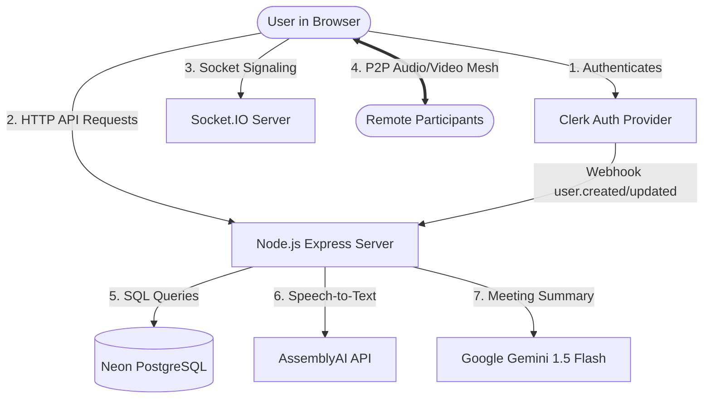
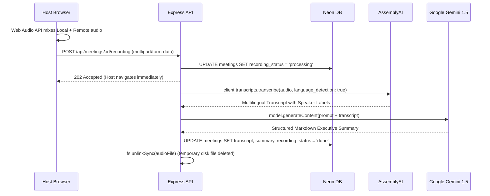

# 📋 Meetup — Complete Project Index & Architecture Guide

> A full-stack, real-time peer-to-peer video calling and meeting intelligence application built with **React 19**, **Node.js (Express 5)**, **Socket.IO**, **WebRTC**, **Clerk Auth**, **Neon PostgreSQL**, **AssemblyAI (Multilingual STT)**, and **Google Gemini 1.5 Flash (AI Summaries)**.

---

## Table of Contents

1. [Project Overview](#1-project-overview)
2. [Tech Stack](#2-tech-stack)
3. [File Structure & Complete File Catalog](#3-file-structure--complete-file-catalog)
4. [Architecture & System Flow](#4-architecture--system-flow)
5. [Authentication & Authorization](#5-authentication--authorization)
6. [Database Schema (Neon PostgreSQL)](#6-database-schema-neon-postgresql)
7. [REST API Endpoints](#7-rest-api-endpoints)
8. [Socket.IO Signaling & Real-Time Events](#8-socketio-signaling--real-time-events)
9. [WebRTC Audio/Video P2P Engine](#9-webrtc-audiovideo-p2p-engine)
10. [AI Audio Recording, Multilingual Transcription & Gemini Summary Engine](#10-ai-audio-recording-multilingual-transcription--gemini-summary-engine)
11. [Client Pages & Routing](#11-client-pages--routing)
12. [Client Components Breakdown](#12-client-components-breakdown)
13. [Custom React Hooks](#13-custom-react-hooks)
14. [Plan Limits & Business Rules](#14-plan-limits--business-rules)
15. [Environment Variables](#15-environment-variables)
16. [Deployment Architecture](#16-deployment-architecture)

---

## 1. Project Overview

**Meetup** is an end-to-end video conferencing and collaborative meeting platform:

- **Authentication**: Seamless Clerk OAuth (Google, Email) with synchronized user profiles in Neon PostgreSQL.
- **Instant Meetings**: 1-click room creation generating clean `abc-def-ghi` room IDs.
- **Invitation Workflow**: Instant share modal on Dashboard and in-room Google Meet-style floating invite card with 1-click Copy Link, Copy ID, and direct WhatsApp sharing.
- **Peer-to-Peer Calls**: Low-latency video and audio streaming via native browser WebRTC with Google STUN servers.
- **Host Controls**: Host can "Mute All" participants in one click, end meeting for all, or allow voluntary participant leave.
- **Real-Time In-Meeting Chat**: Socket.IO room messaging automatically persisted into PostgreSQL `meeting_messages`.
- **Audio Mixing & Processing**: Host browser mixes all audio tracks (local mic + remote peer streams) using Web Audio API (`AudioContext` + `MediaStreamDestination`) and records with `MediaRecorder` (`audio/webm;codecs=opus`).
- **AI Meeting Intelligence**:
  - Automatically transcribes meetings using **AssemblyAI** with multi-language detection (`language_detection: true`) and speaker diarization.
  - Automatically generates structured meeting notes using **Google Gemini** (`gemini-1.5-flash`), formatting Executive Overview, Key Topics, Decisions Made, and Action Items.
- **Historical Sessions**: Full session logs with participants, chat logs, transcripts, and AI executive summaries.

---

## 2. Tech Stack

### Frontend (`/client`)

| Tool | Version | Purpose |
|---|---|---|
| **React** | 19.2.8 | Declarative UI framework |
| **Vite** | 8.2.0 | Next-gen lightning-fast bundler and dev server |
| **React Router DOM** | 7.18.2 | Single-Page Application client routing |
| **@clerk/react** | 6.14.3 | Authentication UI, session management, and JWT tokens |
| **Axios** | 1.19.0 | HTTP client with automatic Clerk Bearer token interceptor |
| **Socket.IO Client** | 4.8.3 | Real-time bidirectional WebRTC signaling and chat client |
| **Tailwind CSS** | 4.3.3 | Utility-first styling with modern `@theme` styling |
| **Lucide React** | 1.31.0 | High quality SVG icon suite |
| **React Hot Toast** | 2.6.0 | Toast notification provider |
| **oxlint** | 1.75.0 | High-performance Rust-based linter |

### Backend (`/server`)

| Tool | Version | Purpose |
|---|---|---|
| **Node.js** | ≥ 20.9.0 | Server-side JavaScript runtime |
| **Express** | 5.2.1 | Minimalist HTTP web framework |
| **Socket.IO** | 4.8.3 | Real-time WebSocket server for signaling & chat |
| **@neondatabase/serverless**| 1.1.0 | High-performance serverless PostgreSQL client |
| **@clerk/express** | 2.1.61 | Express authentication and JWT validation middleware |
| **AssemblyAI** | 4.43.4 | AI speech-to-text with automatic multi-language detection |
| **@google/generative-ai** | 0.24.1 | Google Gemini API SDK for structured summaries |
| **Multer** | 2.5.0 | Multipart/form-data handler for audio uploads |
| **dotenv** | 17.4.2 | Environment variable configuration |
| **cors** | 2.8.6 | Cross-Origin Resource Sharing middleware |
| **cookie-parser** | 1.4.7 | Cookie parsing middleware |

### Cloud Infrastructure

| Provider | Service | Usage |
|---|---|---|
| **Render** | Web Service (Docker / Node) | Backend API & WebSocket server |
| **Render** | Static Site | Vite React frontend hosting |
| **Neon** | Serverless PostgreSQL | Relational DB for users, meetings, participants, messages |
| **Clerk** | Auth Platform | Identity, Google SSO, JWT issuing, Webhooks |
| **Google STUN** | `stun:stun.l.google.com:19302` | WebRTC NAT traversal & candidate discovery |

---

## 3. File Structure & Complete File Catalog

```
meetup/
├── client/
│   ├── public/
│   │   ├── favicon.svg                   # App favicon
│   │   ├── layout_bg.png                 # Background for dashboard / sessions
│   │   ├── login_bg.png                  # Background for login / signup pages
│   │   └── logo.svg                      # MeetUp logo
│   ├── src/
│   │   ├── assets/
│   │   │   └── asset.js                  # Fallback stubs & mock datasets
│   │   ├── components/
│   │   │   ├── meeting/
│   │   │   │   ├── ChatPanel.jsx         # In-room sliding chat panel
│   │   │   │   ├── ControlBar.jsx        # Bottom meeting bar (audio, video, mute-all, end)
│   │   │   │   ├── MeetingInviteModal.jsx# "Your meeting is ready" invite card
│   │   │   │   ├── ParticipantList.jsx   # In-room participant roster drawer
│   │   │   │   ├── VideoGrid.jsx         # Responsive CSS grid for video tiles
│   │   │   │   └── VideoTile.jsx         # Individual video player & avatar placeholder
│   │   │   ├── sessions/
│   │   │   │   ├── EmptySessions.jsx     # Zero-state placeholder for sessions
│   │   │   │   ├── SessionCard.jsx       # Card item on sessions overview
│   │   │   │   ├── SessionChatTab.jsx    # Chat history tab inside session modal
│   │   │   │   ├── SessionDetailModal.jsx# 4-tab details modal for past meetings
│   │   │   │   ├── SessionParticipantsTab.jsx # Participant roster tab
│   │   │   │   ├── SummaryTab.jsx        # Google Gemini AI summary tab
│   │   │   │   └── TranscriptTab.jsx     # AssemblyAI full transcript tab
│   │   │   ├── Footer.jsx                # Global application footer
│   │   │   ├── Loader.jsx                # Centered loading spinner
│   │   │   ├── Navbar.jsx                # Global navigation bar with Clerk UserButton
│   │   │   ├── Protectedlayout.jsx       # Layout shell for authenticated dashboard
│   │   │   └── ProtectedRoute.jsx        # Route guard checking Clerk auth status
│   │   ├── config/
│   │   │   ├── api.js                    # Axios instance with Clerk Bearer interceptor
│   │   │   └── socket.js                 # Socket.IO client singleton
│   │   ├── hooks/
│   │   │   ├── useChat.js                # Chat hook managing messages & unread counts
│   │   │   ├── useRecording.js           # Web Audio API mixer & audio uploader
│   │   │   └── useWebRTC.js              # WebRTC peer connection manager
│   │   ├── pages/
│   │   │   ├── Dashboard.jsx             # Meeting creation, code joining, invite modal
│   │   │   ├── Login.jsx                 # Clerk SignIn / SignUp container
│   │   │   ├── MeetingRoom.jsx           # Core WebRTC video calling experience
│   │   │   ├── Pricing.jsx               # Clerk PricingTable component
│   │   │   └── Sessions.jsx              # Meeting archive with AI summary views
│   │   ├── App.jsx                       # Route registry
│   │   ├── index.css                     # Tailwind CSS v4 styling & theme setup
│   │   └── main.jsx                      # React 19 root bootstrap with ClerkProvider
│   ├── .env                              # Frontend environment variables
│   ├── index.html                        # HTML5 document root
│   ├── package.json                      # Frontend dependencies
│   └── vite.config.js                    # Vite bundler configuration
│
├── server/
│   ├── config/
│   │   └── db.js                         # Neon PostgreSQL connection & table migrations
│   ├── controllers/
│   │   ├── meetingController.js          # Meeting CRUD, stats, sessions, verification
│   │   ├── recordingController.js        # AssemblyAI transcription & Gemini summarization
│   │   └── webhookController.js          # Clerk user sync webhook endpoint
│   ├── middleware/
│   │   └── auth.js                       # JWT verification & automatic user upserting
│   ├── routes/
│   │   └── meetingRoutes.js              # Express meeting API routes & Multer upload
│   ├── uploads/
│   │   └── recordings/                   # Temporary directory for uploaded audio files
│   ├── .env                              # Server secrets & API keys
│   ├── package.json                      # Server dependencies & engines
│   ├── server.js                         # Express entry point, CORS, and HTTP server
│   └── socket.js                         # WebRTC signaling, mute-all, chat broadcasting
│
├── indexing.md                           # Comprehensive codebase documentation (this file)
└── programing.md                         # Architecture logs, feature specs & roadmaps
```

---

## 4. Architecture & System Flow



---

## 5. Authentication & Authorization

### Client Side
- Managed by `@clerk/react`.
- `main.jsx` wraps the application in `<ClerkProvider publishableKey={...}>`.
- `ProtectedRoute.jsx` checks `useAuth().isSignedIn`; redirects unauthenticated requests to `/login`.
- `client/src/config/api.js` attaches the fresh Clerk JWT token to every HTTP request via Axios request interceptor:
  ```js
  const token = await window.Clerk.session.getToken();
  config.headers.Authorization = `Bearer ${token}`;
  ```

### Server Side
- Handled by `server/middleware/auth.js` via `protect` middleware.
- Extracts userId via `@clerk/express` `getAuth(req)`.
- If user does not exist in Neon DB (e.g. webhook has not fired yet), fetches user profile from `clerkClient.users.getUser(userId)` and inserts them into `users` table automatically.
- Sanitizes email uniqueness collisions by prefixing `userId` if needed.
- Syncs user plan (`free` vs `premium`) on every authenticated call.

---

## 6. Database Schema (Neon PostgreSQL)

```sql
-- 1. Users Table
CREATE TABLE IF NOT EXISTS users (
    id VARCHAR(255) PRIMARY KEY,              -- Clerk user ID (e.g., user_2t...)
    name VARCHAR(255) NOT NULL,
    email VARCHAR(255) NOT NULL UNIQUE,
    image VARCHAR(500),
    plan VARCHAR(20) DEFAULT 'free',          -- 'free' | 'premium'
    created_at TIMESTAMPTZ DEFAULT NOW(),
    updated_at TIMESTAMPTZ DEFAULT NOW()
);

-- 2. Meetings Table
CREATE TABLE IF NOT EXISTS meetings (
    id SERIAL PRIMARY KEY,
    meeting_id VARCHAR(50) NOT NULL UNIQUE,   -- Formatted room code: xxx-xxx-xxx
    title VARCHAR(255) DEFAULT 'Instant Meeting',
    host_id VARCHAR(255) NOT NULL REFERENCES users(id) ON DELETE CASCADE ON UPDATE CASCADE,
    status VARCHAR(20) DEFAULT 'active',      -- 'active' | 'ended'
    ended_at TIMESTAMPTZ,
    transcript TEXT,                          -- Formatted speech transcript
    summary TEXT,                             -- Structured Gemini markdown summary
    recording_status VARCHAR(20) DEFAULT 'none', -- 'none' | 'processing' | 'done' | 'failed'
    recording_url TEXT,                       -- Object storage URL (planned)
    created_at TIMESTAMPTZ DEFAULT NOW(),
    updated_at TIMESTAMPTZ DEFAULT NOW()
);

-- 3. Meeting Participants Table
CREATE TABLE IF NOT EXISTS meeting_participants (
    id SERIAL PRIMARY KEY,
    meeting_id INT NOT NULL REFERENCES meetings(id) ON DELETE CASCADE ON UPDATE CASCADE,
    user_id VARCHAR(255) REFERENCES users(id) ON DELETE SET NULL ON UPDATE CASCADE,
    name VARCHAR(255) NOT NULL,
    joined_at TIMESTAMPTZ DEFAULT NOW(),
    left_at TIMESTAMPTZ
);

-- 4. Meeting Messages Table
CREATE TABLE IF NOT EXISTS meeting_messages (
    id SERIAL PRIMARY KEY,
    meeting_id INT NOT NULL REFERENCES meetings(id) ON DELETE CASCADE ON UPDATE CASCADE,
    sender_id VARCHAR(255) REFERENCES users(id) ON DELETE SET NULL ON UPDATE CASCADE,
    sender_name VARCHAR(255) NOT NULL,
    text TEXT NOT NULL,
    timestamp TIMESTAMPTZ DEFAULT NOW()
);
```

---

## 7. REST API Endpoints

All meeting routes require authentication (`Authorization: Bearer <clerk_token>`).

| Method | Endpoint | Handler | Description |
|---|---|---|---|
| `POST` | `/api/meetings` | `createMeeting` | Creates new meeting, verifies monthly limit (30 for free plan) |
| `GET` | `/api/meetings/stats` | `getMeetingStats` | Returns plan, monthly count, limit, and max participant allowance |
| `GET` | `/api/meetings/sessions` | `getUserSessions` | Retrieves meeting history where user was host or participant |
| `GET` | `/api/meetings/sessions/:id` | `getSessionDetails`| Returns full details: participants, chat messages, transcript, summary |
| `POST` | `/api/meetings/:meetingId/recording` | `processRecording` | Uploads host mixed audio file (Multer), starts AI transcription & summary |
| `GET` | `/api/meetings/:meetingId` | `getMeeting` | Validates active meeting status and host details before entering room |
| `POST` | `/api/clerk` | `handleClerkWebhook`| Webhook listener for `user.created`, `user.updated`, `user.deleted` |

---

## 8. Socket.IO Signaling & Real-Time Events

The signaling server tracks active rooms in an in-memory `Map<roomId, Map<socketId, participant>>`.

| Event Name | Direction | Payload | Description |
|---|---|---|---|
| `join-room` | Client → Server | `{ roomId, user, audioEnabled, videoEnabled }` | Verifies room capacity, adds socket to room, persists to DB, emits `all-users` to newcomer and `user-joined` to room |
| `all-users` | Server → Client | `[ { socketId, userId, userName, ... } ]` | Sends list of existing peers to the new participant |
| `user-joined` | Server → Client | `{ socketId, userId, userName, ... }` | Broadcasts to room that a new participant has joined |
| `offer` | Client → Server | `{ targetSocketId, callerSocketId, offer, callerUser }` | Relays WebRTC SDP offer to target peer |
| `answer` | Client → Server | `{ targetSocketId, answer }` | Relays WebRTC SDP answer back to caller |
| `ice-candidate` | Client → Server | `{ targetSocketId, candidate }` | Relays ICE candidate for NAT traversal |
| `toggle-audio` | Client → Server | `{ roomId, audioEnabled }` | Broadcasts `user-toggled-audio` to room |
| `toggle-video` | Client → Server | `{ roomId, videoEnabled }` | Broadcasts `user-toggled-video` to room |
| `send-message` | Client → Server | `{ roomId, message }` | Persists message into `meeting_messages` table and broadcasts `receive-message` |
| `mute-all` | Client → Server | `{ roomId }` | Broadcasts `muted-by-host` to all participants (excluding host) |
| `muted-by-host`| Server → Client | *(None)* | Instructs participant clients to disable their mic track |
| `end-meeting` | Client → Server | `{ roomId }` | Updates DB status to `'ended'`, broadcasts `meeting-ended`, cleans room state |
| `meeting-ended`| Server → Client | `{ message }` | Forces all clients to disconnect and redirect to Dashboard |
| `disconnect` | Internal | *(Socket disconnect)* | Cleans up room participant, broadcasts `user-left` to peers |

---

## 9. WebRTC Audio/Video P2P Engine

Managed inside `client/src/hooks/useWebRTC.js`:

1. **Local Media Acquisition**:
   Calls `navigator.mediaDevices.getUserMedia({ video: true, audio: true })`. If camera or microphone is unavailable, cleanly falls back to audio-only.
2. **Mesh Topology**:
   Each participant maintains a direct `RTCPeerConnection` with every other participant in the room.
3. **STUN Configuration**:
   ```javascript
   iceServers: [
     { urls: "stun:stun.l.google.com:19302" },
     { urls: "stun:stun1.l.google.com:19302" }
   ]
   ```
4. **Signaling Flow**:
   - New participant receives `all-users` and initiates an `offer` to each existing peer.
   - Target peer receives `offer`, sets remote description, generates `answer`, and sends it back.
   - Both sides exchange ICE candidates as discovered.
   - Remote audio/video tracks are attached to the peer's `<VideoTile>` element.

---

## 10. AI Audio Recording, Multilingual Transcription & Gemini Summary Engine

Managed via `useRecording.js` (client) and `recordingController.js` (server).



---

## 11. Client Pages & Routing

All routes declared in `client/src/App.jsx`:

| Route Path | Guard | Page Component | Purpose |
|---|---|---|---|
| `/login` | Public | `Login.jsx` | Clerk SignIn component with `login_bg.png` |
| `/register` | Public | `Login.jsx` | Clerk SignUp component |
| `/dashboard` | Protected | `Dashboard.jsx` | Create meeting, enter code, user stats, copy invite modal |
| `/sessions` | Protected | `Sessions.jsx` | Browse meeting history, open session details & summaries |
| `/pricing` | Protected | `Pricing.jsx` | Upgrade to Premium for 100 participants & unlimited meetings |
| `/meeting/:meetingId` | Protected | `MeetingRoom.jsx` | Main video calling interface with WebRTC grid, chat, invite card |
| `*` | Catch-all | Navigate | Redirects to `/dashboard` |

---

## 12. Client Components Breakdown

### Meeting Room Components (`components/meeting/`)
- **`VideoGrid.jsx`**: Dynamically calculates CSS grid layout from 1 to 100 participants.
- **`VideoTile.jsx`**: Displays participant video stream or animated avatar placeholder with mute icon.
- **`ControlBar.jsx`**: Floating footer with mic toggle, camera toggle, chat toggle (with unread badge), participant list toggle, Mute-All button (host), End Meeting button (host), and Leave button (guests).
- **`MeetingInviteModal.jsx`**: Floating card with 1-click Copy Link, Copy ID, Share on WhatsApp, and "Waiting for others to join..." animated indicator.
- **`ChatPanel.jsx`**: Slide-out drawer with auto-scrolling message list and text submission form.
- **`ParticipantList.jsx`**: Slide-out drawer displaying all connected participants, host badge, and audio/video status.

### Sessions History Components (`components/sessions/`)
- **`SessionCard.jsx`**: Overview card showing date, meeting ID, status badge, participant count, message count, and `AI Summary` / `Processing AI` badge.
- **`SessionDetailModal.jsx`**: Modal dialog with 4 interactive tabs:
  - **`SummaryTab.jsx`**: Renders executive overview, key topics, decisions, and action items with 1-click copy button.
  - **`TranscriptTab.jsx`**: Displays full speaker-diarized transcript with 1-click copy button.
  - **`SessionChatTab.jsx`**: Historical log of all in-meeting chat messages sent during the call.
  - **`SessionParticipantsTab.jsx`**: Roster of attendees with join timestamps.
- **`EmptySessions.jsx`**: Zero-state illustration when no meetings exist yet.

---

## 13. Custom React Hooks

### 1. `useWebRTC(roomId, user, onMeetingEnded, enabled)`
- Connects to Socket.IO signaling server.
- Acquires local camera & microphone stream.
- Maintains `peerConnections` Map for all remote participants.
- Emits and listens to `join-room`, `offer`, `answer`, `ice-candidate`, `user-joined`, `user-left`.
- Exposes `muteAll()` to broadcast mute commands across the room.
- Listens for `muted-by-host` and mutes local microphone track automatically.

### 2. `useRecording(roomId, isHost)`
- Mixes local microphone audio track + all remote peer audio tracks into a unified `MediaStreamDestination` using the Web Audio API.
- Records continuous Opus audio chunks via `MediaRecorder`.
- On meeting end, packages chunks into a WebM Blob and uploads via `multipart/form-data` to `/api/meetings/:meetingId/recording`.
- Ignores recordings smaller than 3KB to prevent empty uploads.

### 3. `useChat(roomId, user)`
- Listens for real-time `receive-message` events.
- Emits `send-message` socket events.
- Tracks `unreadCount` badge when the chat panel drawer is closed.

---

## 14. Plan Limits & Business Rules

| Feature | Free Plan | Premium Plan |
|---|---|---|
| **Monthly Meetings** | 30 meetings / calendar month | Unlimited |
| **Max Participants / Room** | 10 participants | 100 participants |
| **Enforcement Point (Meetings)** | `meetingController.js` (`createMeeting`) checks `COUNT(*)` in current month | Bypassed |
| **Enforcement Point (Capacity)** | `socket.js` (`join-room`) checks `roomParticipants.size >= 10` | Bypassed up to 100 |
| **AI Transcription & Summary** | Included (AssemblyAI + Gemini) | Included |

---

## 15. Environment Variables

### Server (`server/.env`)
```env
ORIGINS="https://meetup-frontend-nf2r.onrender.com,https://meetup-deploy-frontend.onrender.com,http://localhost:5173"
DATABASE_URL="postgresql://<user>:<password>@<neon-host>/neondb?sslmode=require"
CLERK_PUBLISHABLE_KEY="pk_test_..."
CLERK_SECRET_KEY="sk_test_..."
CLERK_WEBHOOK_SIGNING_SECRET="whsec_..."
ASSEMBLYAI_API_KEY="5e6317c1e64644ba848cb2ecdaf4ebb6"
GEMINI_API_KEY="AIzaSy..."
PORT=3000
```

### Client (`client/.env`)
```env
VITE_BASE_URL="https://meetup-backend-fkrm.onrender.com"
VITE_CLERK_PUBLISHABLE_KEY="pk_test_..."
```

---

## 16. Deployment Architecture

- **Main Git Repository**: [github.com/suraj-6699br/Meetup](https://github.com/suraj-6699br/Meetup)
- **Deploy Git Repository**: [github.com/suraj-6699br/Meetup-deploy](https://github.com/suraj-6699br/Meetup-deploy)
- **Render Web Service (Backend)**: Node.js service running `server/server.js` with auto-deploy from `Meetup-deploy.git`.
- **Render Static Site (Frontend)**: Vite SPA build (`dist` directory) with rewrite rule `/*` -> `/index.html`.
